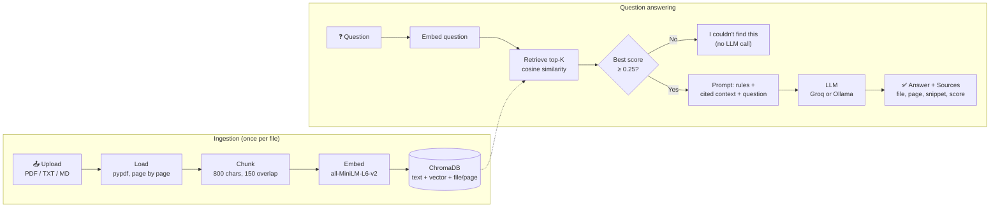

# 📄 DocuMind – RAG Document Q&A Assistant

Upload your PDFs, text or Markdown files and ask questions about them in plain English.
DocuMind finds the most relevant passages, answers **only from your documents**, and shows
the **source file and page number** for every fact. If the answer isn't in your documents,
it says so instead of making something up.


---

## ✨ Features

- **Multi-document upload**: PDF (read page by page), TXT and MD files.
- **Cited answers**: every fact ends with a citation like `[company_leave_policy.pdf, p.2]`.
- **Sources panel**: file, page, similarity score and the exact text snippet used, with ✅ on the cited chunks.
- **Honest "not found"**: two layers stop hallucination (a similarity threshold *and* a strict prompt).
- **Smart ingestion**: duplicate files are skipped (SHA-256 hash), and re-uploading a changed file replaces the old version.
- **Document management**: list documents, delete one, or clear everything (with confirmation).
- **Adjustable Top-K**: a slider controls how many chunks are retrieved per question.
- **Query logs**: every question, answer, source and response time is saved to `logs/queries.jsonl` and shown in a dashboard tab.
- **Two LLM providers**: Groq (fast, free cloud API) or Ollama (fully local), switched with one line in `.env`.
- **Evaluation script**: measures retrieval hit rate, citation accuracy, the correct "not found" rate and response time.
- **Reusable core**: all RAG logic lives in `src/`, separate from the UI, ready to power an AI Exam & Quiz Generator next.

## 📸 Screenshots

> Screenshots coming soon. See [`docs/screenshots/`](docs/screenshots/) for the list to capture.

<!--


-->

## 🏗️ Architecture



**How a question is answered:**
1. The question is turned into a 384-number vector with the same model used for the documents.
2. ChromaDB returns the top-K chunks with the closest meaning (cosine similarity).
3. If even the best chunk scores below **0.25**, the question is unrelated, so the app answers "not found" without calling the LLM.
4. Otherwise the LLM gets strict rules (*answer only from this context, cite every fact, or say the exact not-found sentence*) plus the labelled chunks.
5. The answer is returned with its sources and response time, and logged.

## 🧰 Tech Stack

| Part | Tool | Why |
|---|---|---|
| Language | Python 3.10+ | The standard for AI/ML work |
| Document loading | `pypdf` | Reads PDFs page by page, so page numbers are kept for citations |
| Chunking | LangChain `RecursiveCharacterTextSplitter` | Splits on paragraphs, then sentences, then words, so chunks stay readable |
| Embeddings | `sentence-transformers` – `all-MiniLM-L6-v2` | Free, runs on a laptop CPU, 384-dimensional vectors |
| Vector database | ChromaDB (persistent, local) | No server needed, stores metadata with vectors, supports filters |
| LLM | Groq API (default) / Ollama (local) | Groq is fast and free; Ollama keeps everything offline |
| UI | Streamlit | A full chat web app in pure Python |
| Config | `python-dotenv` | Secrets stay in a git-ignored `.env` file |

## 📁 Project Structure

```
documind-rag/
├── app.py                  # Streamlit UI (no RAG logic, only calls src/)
├── src/
│   ├── config.py           # all settings, loaded from .env and validated
│   ├── loader.py           # PDF/TXT/MD → pages with {source, page}
│   ├── chunker.py          # pages → overlapping chunks with metadata + unique ids
│   ├── embedder.py         # sentence-transformers wrapper (loaded once)
│   ├── vector_store.py     # every ChromaDB operation: add, search, delete, list
│   ├── ingest.py           # load → duplicate check → chunk → embed → store
│   ├── llm.py              # one generate() for Groq or Ollama, friendly errors
│   ├── rag_pipeline.py     # retrieve → threshold → prompt → generate → sources
│   └── logger.py           # appends every query to logs/queries.jsonl
├── eval/
│   ├── test_questions.json # 15 questions (12 answerable + 3 not in the docs)
│   ├── evaluate.py         # hit rate, citation accuracy, not-found rate, timing
│   └── results.md          # latest evaluation report
├── scripts/
│   ├── make_sample_docs.py # builds the demo PDFs
│   ├── ingest_samples.py   # ingests data/sample_docs/
│   └── ask_questions.py    # command-line Q&A test
├── data/sample_docs/       # 2 demo PDFs + 1 Markdown file
├── docs/
│   ├── interview-notes.md  # phase-by-phase explanation of the project
│   └── screenshots/
├── .env.example
├── requirements.txt
└── README.md
```

## 🚀 Setup

**Requirements:** Python 3.10+, about 2 GB of free disk space (PyTorch), about 2 GB of free RAM,
and a free [Groq API key](https://console.groq.com/keys) (or [Ollama](https://ollama.com) installed).

```bash
# 1. Clone the repository
git clone https://github.com/Bharambevaish/documind-rag.git
cd documind-rag

# 2. Create and activate a virtual environment
python -m venv venv
venv\Scripts\activate          # Windows
# source venv/bin/activate     # macOS / Linux

# 3. Install dependencies (downloads PyTorch, so it takes a few minutes)
pip install -r requirements.txt

# 4. Add your settings
copy .env.example .env         # Windows
# cp .env.example .env         # macOS / Linux
#   then open .env and paste your GROQ_API_KEY

# 5. (Optional) Load the sample documents so you can try it straight away
python scripts/ingest_samples.py

# 6. Start the app
streamlit run app.py
```

The app opens at **http://localhost:8501**. The very first run downloads the embedding
model (~90 MB) and can take 30–60 seconds to start.

### Configuration (`.env`)

| Variable | Default | Meaning |
|---|---|---|
| `LLM_PROVIDER` | `groq` | `groq` (cloud) or `ollama` (local) |
| `GROQ_API_KEY` | – | Your Groq key (only needed for `groq`) |
| `MODEL_NAME` | *(empty)* | Empty = `qwen/qwen3.8-27b` on Groq, `llama3` on Ollama |
| `TOP_K` | `4` | Chunks retrieved per question (the UI slider overrides it) |
| `OLLAMA_BASE_URL` | `http://localhost:11434` | Where your Ollama server runs |

**Using Ollama instead of Groq:** install Ollama, run `ollama pull llama3`, set
`LLM_PROVIDER=ollama` in `.env`, and restart the app. No API key or internet needed.

### Command-line tools

```bash
python -m src.config              # print the loaded settings (API key masked)
python scripts/ingest_samples.py  # ingest data/sample_docs/
python scripts/ask_questions.py   # 3 in-doc questions + 1 out-of-doc question
python scripts/ask_questions.py "Can I carry forward unused leave?"
python eval/evaluate.py           # run the evaluation → eval/results.md
```

## 🛡️ How DocuMind Reduces Hallucination

1. **Retrieval grounding**: the LLM only sees text taken from your documents.
2. **Similarity threshold (0.25)**: off-topic questions never reach the LLM. The value was chosen
   by measuring real scores: valid questions scored 0.34–0.72, unrelated ones 0.08–0.14.
3. **Strict system prompt**: answer only from the context, cite every fact, and use one *exact*
   refusal sentence that the code can detect (sources are then hidden, so they can't mislead).
4. **Low temperature (0.1)**: factual, repeatable answers.
5. **Visible sources**: every answer can be checked against the original text.

Layers 2 and 3 cover different cases. *"What is the salary of a software engineer at Northwind?"*
is on-topic (score 0.45), so it passes the threshold, and the prompt makes the LLM refuse.

## 📊 Evaluation Results

`python eval/evaluate.py` runs 15 test questions through retrieval and the full pipeline
(`qwen/qwen3.8-27b` on Groq, Top-K = 4):

| Metric | Result |
|---|---|
| Retrieval hit rate @4 | **100%** (12/12) |
| MRR (mean reciprocal rank) | **1.00**: the correct page was always ranked first |
| Citation accuracy | **100%** (12/12): answered *and* cited the expected page |
| Correct "not found" | **100%** (3/3) |
| Avg response time | **1.35 s** (answers ≈ 0.6–1.9 s, refusals by the LLM ≈ 5 s) |
| LLM calls skipped by the threshold | 1/15 (the off-topic question answered in 0.02 s) |

**What the metrics mean**
- *Hit rate @K*: was the page holding the answer among the K retrieved chunks? If retrieval misses, the LLM can't answer correctly, so this is the first thing to check.
- *MRR*: the average of 1 / rank of the first correct chunk (1.0 = always first).
- *Citation accuracy*: the end-to-end check, meaning the right answer with the right citation.

**Honest limitation:** the test set is small (3 documents, 16 chunks), and the documents and
questions were written by the same person, so these numbers are optimistic. They show the
pipeline works correctly end to end, not that it will score 100% on large real-world PDFs.
The next step would be a bigger test set built from real documents and real user questions
(the query logs are a good source). Full report: [`eval/results.md`](eval/results.md).

## 🔄 A Real-World Lesson: the Groq Model Change

The original plan used **Llama 3** on Groq. While building the generation step, the first
test failed with *"model not found"*: Groq had retired its Llama 3 chat models. Because the
model name is a setting, not hard-coded, the fix took minutes:

1. Listed the models available to the API key with Groq's `models.list()`.
2. Tested the two candidates, `openai/gpt-oss-20b` and `qwen/qwen3.8-27b`, on the same RAG prompt.
3. Both refused correctly, but **Qwen3 followed the `[file, p.N]` citation format most reliably**
   (`gpt-oss` sometimes used its own `【…】` style), so it became the default.
4. Added code that strips `<think>…</think>` blocks, which reasoning models such as Qwen3 and DeepSeek-R1 may output.

**Takeaway:** external APIs change. Keeping the provider behind one `generate()` function and
the model name in `.env` turned a breaking change into a one-line config update.

## 🧯 Troubleshooting

| Problem | Fix |
|---|---|
| `GROQ_API_KEY is missing` | Copy `.env.example` to `.env` and add your key, then restart the app |
| `Groq model ... not found` | The model was retired; pick one from [Groq's model list](https://console.groq.com/docs/models) and set `MODEL_NAME` |
| `Could not reach Ollama` | Start it with `ollama serve`, and run `ollama pull llama3` |
| App stays blank or crashes on start | Usually low memory: PyTorch needs about 1–2 GB free. Close other apps and try again |
| Very slow install or file-lock errors | Avoid keeping the project (and its `venv`) inside a OneDrive or Dropbox synced folder |
| "unauthenticated requests to the HF Hub" warning | Harmless; it only appears when the embedding model is downloaded |
| A scanned PDF gives "No text found" | Scanned PDFs are images; OCR isn't supported yet (see Future Work) |

## 🔮 Future Work

- **AI Exam & Quiz Generator**: reuse `loader`, `chunker`, `embedder` and `vector_store` to
  generate MCQs with answer keys from uploaded notes, each question linked to its source page.
- **Re-ranking**: retrieve ~20 chunks, then re-order them with a cross-encoder
  (e.g. `ms-marco-MiniLM`) and keep the best 4 for higher precision.
- **Hybrid search**: combine vector search with keyword search (BM25), so exact terms such as
  names, codes and numbers are found even when their embeddings aren't close.
- **Bigger or better models**: stronger embedding models (e.g. `bge`, `e5`) and larger LLMs, compared using `eval/evaluate.py`.
- **OCR** for scanned PDFs (Tesseract), plus support for DOCX and web pages.
- **Streaming answers** (token by token) for a faster feel.
- **Multi-user support**: login plus a `user_id` in chunk metadata, so each user sees only their documents.
- **Automated tests + CI** with GitHub Actions running the evaluation on every push.

## 👩‍💻 Author

**Vaishnavi Bharambe**, final-year IT student.
GitHub: [@Bharambevaish](https://github.com/Bharambevaish)
